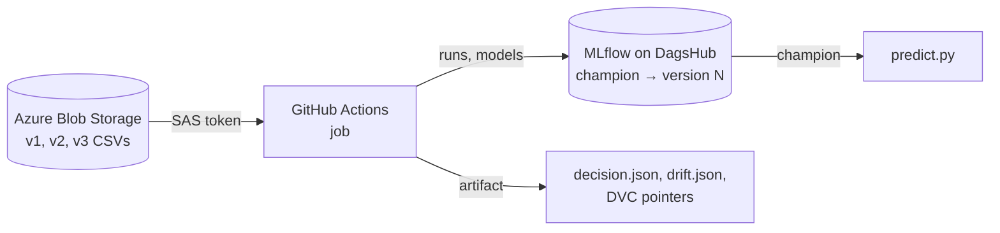
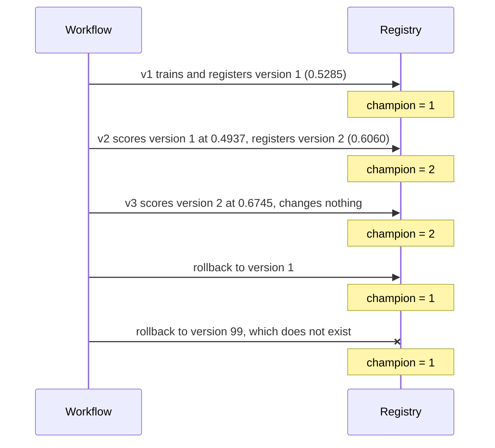
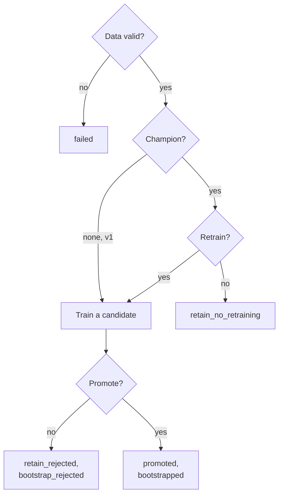

# CI/CD/CT for bank marketing: solution guide

A bank's classifier predicts whether a client will subscribe to a term deposit. Labeled data
arrives in three batches, `v1`, `v2` and `v3`. A GitHub Actions workflow handles each batch: it
validates the data, evaluates the production model, retrains when the policy says so, and deploys
the new model only if it passes the quality gate. Then the same workflow rolls production back to
an earlier approved model.

The teacher's starter holds the whole Python application. The work is to set up the repository,
connect it to DagsHub, add the workflow, run it on the three batches and on a rollback, and explain
each decision.

You hand in the link to a **private** GitHub repository named `bank-marketing-ci-cd-ct`, with the
teacher added as a collaborator with the Read role.

**Starting point:** the handout `EXERCISE.pdf` and the starter `starter.zip` (the teacher's
`starter-code.zip`). `solution/` holds the two files the solution adds: the workflow and a short
`README.md`. The starter's Python files are not changed.

**What was checked:** everything below was run on 21 November 2026: the workflow on GitHub's
`ubuntu-latest` runners with Python 3.12 and the starter's pinned versions (MLflow 2.22.5), against
a DagsHub project. The same sequence was also replayed locally first. The outputs shown are the
real ones. The registry state was read through the MLflow API.

**Credentials:** your DagsHub access token and the class SAS token are secrets. They go into
GitHub secrets, never into a file that Git tracks. In this guide the SAS token is written
`<SAS_TOKEN>`; use the one in your handout. The handout calls it a read token, but its `sp=racwdl`
field allows reading, adding, creating, writing, deleting and listing in the class container, so
treat it with care.

## How the pieces fit

| What | Where |
| --- | --- |
| The application and the workflow | the GitHub repository |
| The three dataset versions (`train.csv` and `evaluation.csv` each) | the teacher's Azure Blob Storage, read with the SAS token |
| The DVC hash of each input file | computed in a temporary folder on each run, saved in the run's artifact |
| Runs, metrics, models and the model registry | DagsHub's MLflow server for the repository |
| The production model | the registered model `bank-marketing`, whichever version its `champion` alias points to |

"Deploying" a model here means moving the `champion` alias. `predict.py` asks the registry which
version `champion` selects and loads that version. No server is involved.



Over the five runs of this guide, the `champion` alias moves like this:



## Part 1: The repository

### 1. Create it

1. On GitHub, create a **private** repository named `bank-marketing-ci-cd-ct`, with no README.
2. Clone it, and extract the starter **into the repository's root** so `pipeline.py` sits next to
   `.git`. The starter contains a hidden `.gitignore`. Use `unzip`, which keeps it:

   ```bash
   git clone git@github.com:<you>/bank-marketing-ci-cd-ct.git
   cd bank-marketing-ci-cd-ct
   unzip ~/Downloads/starter-code.zip -d .
   ls -A
   ```

   You should see `.gitignore`, `data.py`, `model.py`, `pipeline.py`, `policy.py`, `predict.py`,
   `registry.py` and `requirements.txt`. The `.gitignore` keeps the downloaded data
   (`.exercise-data/`), the results and local MLflow files out of Git.

3. Commit and push:

   ```bash
   git add -A && git commit -m "Add the starter application" && git push
   ```

### 2. Install it and check the CLI

```bash
python3.12 -m venv .venv && source .venv/bin/activate
pip install -r requirements.txt
python pipeline.py --help
```

```text
usage: pipeline.py [-h] (--dataset-version {v1,v2,v3} | --rollback VERSION)

Evaluate a dataset release or roll back the approved production model.
```

`python predict.py --help` shows `--input` and `--limit`. Use Python 3.12, as the workflow does;
the pinned versions in `requirements.txt` were chosen for it.

## Part 2: DagsHub and MLflow

### 3. Connect the repository to DagsHub

1. Sign in to DagsHub (**Sign in with GitHub** is simplest).
2. **Create → Connect a repository → GitHub**, and pick `bank-marketing-ci-cd-ct`. The repository
   is private, so GitHub first asks you to give DagsHub access to it. Keep the name
   DagsHub suggests: the DagsHub project becomes a private mirror of the GitHub repository.
3. In the DagsHub project, **Remote → MLflow** shows the tracking URI:
   `https://dagshub.com/<owner>/bank-marketing-ci-cd-ct.mlflow`. Open it while signed in; the MLflow
   page should load, still empty.
4. Create a token: your avatar → **User Settings → Tokens**.

### 4. Variables and secrets

In the GitHub repository: **Settings → Secrets and variables → Actions**.

| Tab | Name | Value |
| --- | --- | --- |
| Variables | `MLFLOW_TRACKING_URI` | the tracking URI, ending in `.mlflow` |
| Variables | `MLFLOW_TRACKING_USERNAME` | your DagsHub login |
| Secrets | `MLFLOW_TRACKING_PASSWORD` | your DagsHub token |
| Secrets | `AZURE_SAS_TOKEN` | `<SAS_TOKEN>` from the handout |

With the GitHub CLI, from the repository folder (each `gh secret set` asks you to paste the value):

```bash
gh variable set MLFLOW_TRACKING_URI --body "https://dagshub.com/<owner>/bank-marketing-ci-cd-ct.mlflow"
gh variable set MLFLOW_TRACKING_USERNAME --body "<dagshub-login>"
gh secret set MLFLOW_TRACKING_PASSWORD
gh secret set AZURE_SAS_TOKEN
```

**Copy the SAS token carefully.** In the PDF the token is split over three lines, and copying it
can lose the hyphen at the end of the first two lines (`st=2026-11-` and `sv=2026-02-`). The token
must be one line, starting with `sp=` and ending with `%3D`. Check it before saving it:

```bash
curl -sI "https://wut2026.blob.core.windows.net/dvc/processed-datasets-ci-cd-ct/v1/train.csv?<SAS_TOKEN>" | head -1
```

`HTTP/1.1 200 OK` means the token works; `403` means it is damaged or expired. The token in the
handout expires on 31 December 2026 (its `se=` field).

## Part 3: The workflow

### 5. What the application does

Read `pipeline.py` from `run_release` down. For a dataset run it:

1. **Fetches and fingerprints the data** (`data.fetch_and_track`): downloads the version's
   `train.csv` and `evaluation.csv` with the SAS token, then runs `dvc init --no-scm` and
   `dvc add` in a temporary folder. The resulting `.dvc` pointer files record each file's MD5. They
   are kept as evidence; your Git tree stays clean.
2. **Validates** (`data.validate_splits`): the exact column header; no missing values; every
   category from a known list; integers in plausible ranges; both classes present; `source_row`
   unique and increasing; and every training row older than every evaluation row.
3. **Evaluates the champion,** if there is one: ROC-AUC, average precision and positive rate on
   the evaluation rows. It also compares each feature with the champion's training data and writes
   `drift.json`.
4. **Decides whether to retrain** (`policy.needs_retraining`). If not, the run ends with
   `retain_no_retraining`.
5. **Trains a candidate** on `train.csv` (one-hot encoding, scaling, logistic regression), scores
   it on the same evaluation rows, and logs it to MLflow.
6. **Decides whether to promote** (`policy.passes_promotion`). If yes, it registers the candidate
   as a new version tagged `approval: approved`, together with its score and training cutoff. Then
   it moves `champion` to it, after checking that nobody moved the alias during the run.

The decisions of a dataset run, with the `decision` value each one writes (the rules are in the
table below):



A rollback (`roll_back`) only accepts a version tagged `approved`. It loads the model once to make
sure it still works, then moves `champion`.

The gates in `policy.py`:

| Decision | Rule |
| --- | --- |
| Bootstrap | the first model needs ROC-AUC ≥ 0.51 on v1's evaluation rows |
| Retrain | the champion is below 0.51, or at least 0.03 below its score when approved |
| Promote | the candidate is ≥ 0.51 and at least 0.02 above the champion on the same rows |
| Drift flag | a feature's total variation distance from the champion's training data is ≥ 0.20; it is only reported |

### 6. Add the workflow

Create `.github/workflows/ml-pipeline.yml` with the workflow from the handout, unchanged. In the
PDF, the prediction step's `run:` line wraps; in the file it is one line:

```yaml
        run: python predict.py --input ".exercise-data/$DATASET_VERSION/evaluation.csv" --limit 3
```

What its parts do:

- `workflow_dispatch` with three inputs: `operation` (`pipeline` or `rollback`), `dataset_version`
  and `rollback_version`. Each step runs only for its operation, so a dataset run can never roll
  back.
- `concurrency: bank-marketing-production` with `cancel-in-progress: false` queues runs instead of
  running two that could both move the alias.
- `permissions: contents: read` and `persist-credentials: false`: the job cannot write to the
  repository.
- Dispatch inputs reach the shell as environment variables, quoted (`"$DATASET_VERSION"`), never as
  `${{ inputs... }}` pasted into the command, which would let an input inject shell code.
- The last step uploads `results/` as the `pipeline-results` artifact even when a step failed
  (`if: always()`).

Commit and push it to the default branch:

```bash
git add .github/workflows/ml-pipeline.yml
git commit -m "Add the CI/CD/CT workflow" && git push
```

**If "Run workflow" does not appear,** check **Actions**: the workflow must be listed there. Here
the repository was created and pushed in one command (`gh repo create --source . --push`), and
GitHub did not register the workflow. Dispatching failed with
`HTTP 404: workflow ml-pipeline.yml not found on the default branch`. A later push that did not
touch the workflow did not help. What fixed it was pushing the commit that adds the workflow again,
by moving `main` back to the starter commit and pushing both commits again. The history does not
change:

```bash
git push --force origin <starter-commit>:main && git push origin main
```

## Part 4: Bootstrap production with v1

### 7. Run it

**Actions → Bank Marketing CI/CD/CT → Run workflow**, on the default branch, with `pipeline` and
`v1`, and `rollback_version` left blank. Or:

```bash
gh workflow run ml-pipeline.yml -f operation=pipeline -f dataset_version=v1
```

The run takes about a minute and a half. Wait for it to finish before starting v2.

Two warnings in the log are harmless: scikit-learn's `OptimizeWarning: Unknown solver options:
iprint` (a newer SciPy) and MLflow's hint about integer columns in the inferred schema.

### 8. Check the evidence

On the run's page, under **Artifacts**, download `pipeline-results`. Its `decision.json`:

```json
{
  "candidate_metrics": {
    "average_precision": 0.059505256837557044,
    "positive_rate": 0.05254424778761062,
    "roc_auc": 0.5284534672934527
  },
  "candidate_model_uri": "runs:/75fc3dcd597c46a9928f8f88bdd4dc10/model",
  "candidate_version": "1",
  "champion_after": "1",
  "champion_before": null,
  "dataset_version": "v1",
  "decision": "bootstrapped",
  "dvc": {
    "evaluation": "3e90405ff8047eaa610812243555c217",
    "train": "0288c9cde3c23ffd3e34c1963989a036"
  },
  "model_name": "bank-marketing",
  "operation": "pipeline",
  "retrained": true,
  "run_id": "75fc3dcd597c46a9928f8f88bdd4dc10",
  "validation": "passed"
}
```

`validation` is `passed` and `decision` is `bootstrapped`. Write down `run_id` and `champion_after`
(here `1`): that is the version you roll back to at the end. `manifests/` holds the two DVC
pointers, for example:

```yaml
outs:
- md5: 0288c9cde3c23ffd3e34c1963989a036
  size: 2917497
  hash: md5
  path: train.csv
```

The prediction step's log shows the same version and three probabilities:

```json
{
  "model_name": "bank-marketing",
  "model_version": "1",
  "probability_yes": [
    0.6628024993243603,
    0.6745150403370966,
    0.7986182919197949
  ]
}
```

In MLflow (the tracking URI, signed in):

- **Experiments → bank-marketing-ci-cd-ct:** the run named `v1` with the same run ID. It has the
  `dataset_version` tag, the `candidate_roc_auc` metric, the DVC hashes as parameters
  (`dvc_train_md5`, `dvc_evaluation_md5`), and the artifacts `decision.json`, `manifests/`,
  `model/` and `training-profile.json` (the reference used by later drift checks).
- **Models → bank-marketing:** version 1, with the `champion` alias and the tags
  `approval: approved`, `approval_roc_auc`, `approval_run_id`, `dataset_version: v1` and
  `training_last_source_row: 24064`.

The bootstrap needs a DagsHub project with no `champion` for `bank-marketing` yet. To run the
sequence again from scratch, use a new DagsHub project, or the local replay at the end of this
guide.

## Part 5: v2 and v3

### 9. Run them one after the other

```bash
gh workflow run ml-pipeline.yml -f operation=pipeline -f dataset_version=v2
# after it finishes and you have checked it:
gh workflow run ml-pipeline.yml -f operation=pipeline -f dataset_version=v3
```

The decisions:

| Run | Champion before → after | Champion ROC-AUC | Approval ROC-AUC | Candidate ROC-AUC | Decision |
| --- | --- | --- | --- | --- | --- |
| v1 | none → 1 | | | 0.5285 | `bootstrapped` |
| v2 | 1 → 2 | 0.4937 | 0.5285 | 0.6060 | `promoted` |
| v3 | 2 → 2 | 0.6745 | 0.6060 | | `retain_no_retraining` |

These match the handout's expected values (0.528, 0.494, 0.606, 0.674). In v2 and v3 the
prediction step used versions 2 and 2.

### 10. Explain the decisions

- **v2:** version 1 scores 0.4937. Both retraining conditions hold: it is below 0.51, and it is
  0.0347 below its approval score (the limit is 0.03). The candidate is trained on the training
  rows available at v2 (32,608 rows, up to `source_row` 36,224). On the same evaluation rows it
  scores 0.6060: above 0.51, and 0.1123 better than the champion (0.02 needed). It is registered
  as version 2 and promoted.
- **v3:** version 2 scores 0.6745. That is above 0.51 and above its own approval score of 0.6060,
  so neither retraining condition holds. The run logs the monitoring results and keeps the
  champion; no candidate is trained.

**If `MIN_ROC_AUC_IMPROVEMENT` were 0.12,** the v2 candidate would still be trained, because the
retraining gate does not change. But 0.6060 − 0.4937 = 0.1123 is below 0.12, so the decision would
be `retain_rejected`. The candidate would stay a logged model in the run, not registered, and
version 1 would remain champion, although it ranks worse than chance on v2.

### 11. Drift against the deployment decision

`drift.json` compares the evaluation batch with the **champion's** training data: v2 against v1's
training rows, v3 against v2's. Twelve features are flagged in each report. Four of them:

| Feature | v2 | v3 |
| --- | --- | --- |
| `campaign` | 0.204, flagged | 0.142 |
| `pdays` | 0.173 | 0.361, flagged |
| `previous` | 0.000 | 0.000 |
| `nr.employed` | 1.000, flagged | 1.000, flagged |

- **The reference changes with the champion.** `campaign` is flagged in v2 but not in v3, and
  `pdays` the other way round, because v3 is compared with version 2's later training rows.
- **`pdays`** is the number of days since a previous campaign's contact, and 999 means never
  contacted. All of v1's training rows have 999. In v2's evaluation rows 17% of clients had been
  contacted before, in v3's 37%, against under 1% in v2's training rows.
- **`previous`** (the number of earlier contacts) scores 0.000 twice. Yet clients with at least one
  earlier contact go from 2 in 24,064 in v1's training rows to 38% and 60% of the v2 and v3
  evaluation rows. The check bins each number by the reference's deciles. When at least 90% of the
  reference is 0, every decile is 0, everything lands in one bin, and the change is invisible.
- **The economic indicators** (`nr.employed`, `euribor3m`, `emp.var.rate`, `cons.price.idx`) score
  0.63 to 1.00 in both reports. They describe the economy at the time of the call, and the batches
  are consecutive periods, so they always look different from the training period.

**Why the two can tell different stories:** the drift reports look much the same, twelve flags
each, but the decisions are opposite. Drift measures a change in the inputs. Performance
degradation needs labels: in v2 the champion's ranking fell below chance. That fits concept drift,
a change in how the inputs relate to the outcome, or a move into situations the old training data
never covered, and the drift report alone cannot tell which. In v3 the inputs changed just as much,
but the champion ranks clients better than when it was approved. Retraining there would cost
compute and a deployment for no measured gain. That is why the performance gate, not the drift
flags, decides retraining.

**About the other metrics:** the positive rate goes from 5.3% (v1) to 38.3% (v2) to 48.5% (v3). A
model that ranks at random gets an average precision equal to the positive rate, so average
precision cannot be compared across batches. ROC-AUC is 0.5 for random ranking whatever the class
balance, which is why the gates use it.

## Part 6: Roll back production

### 12. Restore version 1

Before: in **Models → bank-marketing**, `champion` is on version 2, and version 1 is tagged
`approval: approved` from the v1 run. Then:

```bash
gh workflow run ml-pipeline.yml -f operation=rollback -f rollback_version=1
```

The `dataset_version` input keeps its default and is ignored. Of the three pipeline steps, only
the restore step runs. Its `decision.json`:

```json
{
  "champion_after": "1",
  "champion_before": "2",
  "dataset_version": null,
  "decision": "rolled_back",
  "model_name": "bank-marketing",
  "operation": "rollback",
  "retrained": false,
  "rollback_version": "1",
  "run_id": "8965842f7ec84728955c0a8a400603c0",
  "validation": "not_applicable"
}
```

In MLflow, the experiment has a run named `rollback` with this run ID, and `champion` is back on
version 1.

### 13. A bad rollback must fail

Request a version that does not exist:

```bash
gh workflow run ml-pipeline.yml -f operation=rollback -f rollback_version=99
```

The run fails at **Restore a previously approved version**, as it should, and still uploads its
results (shortened here):

```json
{
  "champion_after": "1",
  "champion_before": "1",
  "decision": "failed",
  "error": "MLflow request failed (RESOURCE_DOES_NOT_EXIST)",
  "rollback_version": "99"
}
```

The registry still has `champion` on version 1. The other refusal, a version that exists but is not
approved, cannot happen in this sequence: rejected candidates are never registered.

The MLflow experiment now holds five runs: `v1` (bootstrapped), `v2` (promoted), `v3` (retained),
`rollback` (rolled back) and `rollback` (failed).

## Part 7: Submit

1. **Settings → Collaborators → Add people:** `khodorhammoud`.
2. Submit the repository's URL in the Teams assignment. The default branch must hold the full
   source, `requirements.txt` and the workflow.

**About the Read role:** a repository owned by a personal account has no roles to choose from.
Every collaborator can read and push, and the page is called **Collaborators**, not
**Collaborators and teams**. The Read role exists only for repositories owned by an organization.
So on a personal account, the invitation gives the teacher write access. To give real read-only
access, the repository would have to belong to an organization.
## Optional: replay locally

Running the same sequence locally checks everything without touching the DagsHub model. The
pipeline reads `MODEL_NAME` and `MLFLOW_EXPERIMENT_NAME`, so use a local MLflow store and separate
names:

```bash
export MLFLOW_TRACKING_URI=sqlite:///mlflow.db
export MODEL_NAME=bank-marketing-replay MLFLOW_EXPERIMENT_NAME=bank-marketing-replay
export AZURE_SAS_TOKEN='<SAS_TOKEN>'
python pipeline.py --dataset-version v1
python predict.py --input .exercise-data/v1/evaluation.csv --limit 3
python pipeline.py --dataset-version v2
python pipeline.py --dataset-version v3
python pipeline.py --rollback 1
```

Each command prints its `decision.json`. The local replay gave exactly the same scores as the
workflow. `mlflow.db`, `mlruns/` and `.exercise-results/` are already in
`.gitignore`.

## Checklist

- The private repository `bank-marketing-ci-cd-ct` holds the starter's files at its root,
  `requirements.txt` and `.github/workflows/ml-pipeline.yml`.
- Two variables and two secrets are set; no token is in any tracked file.
- Four green runs (v1, v2, v3, rollback to the v1 version) and one red run (the bad rollback).
- In MLflow: versions 1 and 2 of `bank-marketing`, both approved, with `champion` on version 1.
- `khodorhammoud` invited as a collaborator, and the URL submitted.
