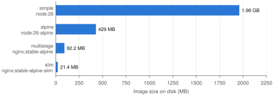

<div class="abstract" markdown="1">
**Abstract.** This lab packages a small front-end authentication application as a Docker image, first with a straightforward single-stage Dockerfile and then with a multi-stage build. The single-stage image works but takes 1.96 GB on disk to serve about 5 kB of static files. Switching to an Alpine base reduced it to 429 MB, and a multi-stage build that serves only the compiled files with nginx reduced it to 92.2 MB, 21 times smaller, while the same end-to-end tests still passed. Using the slim variant of the nginx image brought the final image down to 21.4 MB. The exercises examined layer caching, the role of `.dockerignore` and the contents of the final container.
</div>

## 1. Objective

A Docker image contains an application together with everything it needs to run, so that it behaves the same on any machine. The objectives of the lab were to write a working Dockerfile, to understand layers and the build cache, and to make the image as small as possible with a multi-stage build, measuring the effect at each step.

## 2. Application and environment

The application is a front-end-only version of the registration and login app from the previous labs, built with Vite. In development it runs on the Vite dev server (port 5173); for production, `npm run build` compiles it into static HTML, CSS and JavaScript in `dist/`. Two Playwright end-to-end tests check that a registered user can log in and that invalid credentials show an error.

All builds ran on an Apple M1 Pro with Docker Desktop (Docker Engine 29.9.2, containerd image store), so the images are `linux/arm64`; sizes on an x86 machine are close but not identical. `docker run --rm hello-world` confirmed that the installation worked.

## 3. Part 1: a single-stage image

### 3.1 Dockerfile and build context

The Dockerfile from the guide was used unchanged:

```dockerfile
FROM node:26
WORKDIR /app
COPY package.json package-lock.json ./
RUN npm ci
COPY . .
EXPOSE 5173
CMD ["npm", "run", "dev", "--", "--host", "0.0.0.0"]
```

The dependency files are copied and installed before the rest of the code. Each instruction produces a cached layer, and a layer is rebuilt only if its inputs or a layer before it changed, so editing source code does not reinstall the dependencies (verified in exercise 1). `--host 0.0.0.0` makes Vite accept connections from outside the container; by default it listens only on the container's own `localhost`, which the host cannot reach.

A `.dockerignore` file excludes `node_modules`, `dist`, test reports, `.git`, Markdown files and the Docker files themselves from the build context. With it, the context sent to the builder was 36.35 kB.

### 3.2 Build, run and test

<p class="caption"><b>Table 1.</b> Build times of the single-stage image.</p>

| Build | Time | Notes |
|---|--:|---|
| First build | 55.8 s | pulls `node:26` (about 490 MB compressed); `npm ci` 3.3 s |
| Rebuild without changes | 2.2 s | every step reported `CACHED` |

The container was started with `docker run --rm -p 5173:5173 node-auth-app:simple`, which maps port 5173 of the host to port 5173 of the container. The logs showed Vite 8.3.5 listening on all interfaces, and the page loaded at `http://localhost:5173`. With the container running in the background (`-d --name auth-app`), `npx playwright test` reported 2 passed in 4.5 s. Because a server was already listening on port 5173, Playwright's `reuseExistingServer` setting made it test the container instead of starting its own server.

## 4. Part 2: reducing the image size

### 4.1 The problem

`docker images` reported 1.96 GB on disk (493 MB compressed) for the single-stage image. The compiled application, in contrast, is three files of 5,013 bytes in total (`index.html` 0.46 kB, CSS 0.80 kB, JavaScript 3.74 kB). `docker history` shows where the space goes:

<p class="caption"><b>Table 2.</b> Largest layers of <code>node-auth-app:simple</code>.</p>

| Layer | Size |
|---|--:|
| Debian base and build tools from `node:26` (several `apt-get` layers) | about 1.1 GB |
| Node.js itself | 240 MB |
| `RUN npm ci` (77 MB `node_modules` and 29 MB npm cache) | 113 MB |
| `COPY . .` (the application source) | 45.1 kB |

The image ships a full Debian system with compilers, Node.js, npm, all development dependencies and a development server. None of it is needed to serve three static files.

### 4.2 A smaller base image

Changing the first line to `FROM node:26-alpine` produced a 429 MB image (127 MB compressed) in 18.4 s. Alpine Linux is a minimal distribution of a few megabytes, but the image still contains Node.js (180 MB in that base) and the 113 MB dependency layer, and it still runs the development server. The Dockerfile was changed back afterwards.

### 4.3 Multi-stage build

`Dockerfile.multistage` uses two stages. The first, named `builder`, starts from `node:26-alpine`, installs the dependencies and runs `npm run build`. The second starts from `nginx:stable-alpine` and copies only the compiled files out of the first stage:

```dockerfile
FROM node:26-alpine AS builder
WORKDIR /app
COPY package.json package-lock.json ./
RUN npm ci
COPY . .
RUN npm run build

FROM nginx:stable-alpine
COPY --from=builder /app/dist /usr/share/nginx/html
EXPOSE 80
```

Only the last stage becomes the image; the builder stage, with Node.js and `node_modules`, is discarded. The build took 6.3 s because every builder step up to `COPY . .` was reused from the cache of the Alpine image built just before. The container was started with `-p 5173:80`, since nginx listens on port 80, and the same Playwright tests, unchanged, reported 2 passed.

### 4.4 Comparison

<p class="caption"><b>Table 3.</b> Image sizes. "Disk" is the unpacked size, "compressed" is what a pull downloads.</p>

| Image | Base of the final stage | Disk | Compressed | Guide's estimate |
|---|---|--:|--:|--:|
| `simple` | `node:26` | 1.96 GB | 493 MB | > 1 GB |
| `alpine` | `node:26-alpine` | 429 MB | 127 MB | 250–300 MB |
| `multistage` | `nginx:stable-alpine` | 92.2 MB | 26 MB | about 50 MB |
| `slim` (exercise 4) | `nginx:stable-alpine-slim` | 21.4 MB | 6.11 MB | – |

<figure>

<figcaption><b>Figure 1.</b> Image size on disk. The multi-stage image is 21 times smaller than the single-stage one, and the slim variant 92 times smaller.</figcaption>
</figure>

The Alpine and multi-stage images are larger than the guide's estimates. For `alpine`, Node.js alone takes 180 MB in the current `node:26-alpine` base. For `multistage`, the current `nginx:stable-alpine` image includes optional nginx modules (njs, ACME, GeoIP, image filter, XSLT) and their libraries, 71 Alpine packages in total, with a 51 MB main layer. In the multi-stage image the layer added by `COPY --from=builder` is only 36.9 kB.

A smaller image downloads and starts faster, costs less to store, and contains fewer packages that can have security vulnerabilities. The two images also serve different purposes: the single-stage image runs a development server with hot reload and unminified code, while the multi-stage image serves the optimised production build.

## 5. Exercises

### 5.1 The build cache

After changing a text in `src/main.js`, rebuilding `:simple` took 1.3 s. `WORKDIR`, `COPY package.json package-lock.json` and `RUN npm ci` were reported as `CACHED`; only `COPY . .` ran again, because one of the files it copies had changed.

Adding a dependency was tested in two ways. Editing `package.json` by hand without updating the lock file made the build fail: the `COPY` of the dependency files was no longer cached, and `npm ci` stopped with "`npm ci` can only install packages when your package.json and package-lock.json are in sync" (missing `ms@2.1.3` from the lock file). `npm ci` installs exactly what the lock file pins, or nothing. Adding the dependency properly with `npm install ms`, which updates both files, gave a successful build in 5.9 s in which only `WORKDIR` was cached. Changing the dependency files invalidates their `COPY` layer and every layer after it, so `npm ci` reinstalled all 21 packages, not only the new one, and `COPY . .` ran again. With a large dependency tree this is the step that takes minutes, which is why it is placed before the frequently changing source code. All files were restored afterwards.

### 5.2 Removing `node_modules` from `.dockerignore`

The `node_modules` line was removed, `npm install` was run on the host (49 MB of `node_modules`), and the image was rebuilt under a separate tag.

<p class="caption"><b>Table 4.</b> Effect of sending <code>node_modules</code> to the builder.</p>

| | Build context | `COPY . .` layer | Image size | Rebuild time |
|---|--:|--:|--:|--:|
| `node_modules` ignored | 36.35 kB | 45.1 kB | 1.96 GB | 1.3 s |
| `node_modules` sent | 50.15 MB | 51.7 MB | 2.02 GB | 3.2 s |

The build became slower: the whole folder is transferred to the builder on every build (0.7 s here), the `COPY . .` layer grows a thousand times, and any local `npm install` invalidates that layer even when no source file changed. With a larger project or a remote builder the cost grows accordingly.

Copying the host's `node_modules` is also risky because it contains native binaries compiled for the host operating system. On the Mac, npm installed the macOS builds of Rolldown and Lightning CSS (`binding-darwin-arm64`, a Mach-O library) and the macOS-only `fsevents` package. Loading Rolldown from the Mac's `node_modules` inside a Linux `node:26` container failed with "Cannot find native binding". In this build the application still started, but only because `COPY . .` merged the host folder on top of the Linux `node_modules` installed by `npm ci`, leaving the Linux bindings in place. Every file present on both sides was replaced by the host's version, so a native module compiled to the same path on every platform (for example a `node-gyp` module such as `bcrypt`) would fail with an "invalid ELF header" error. The image would also no longer contain what `package-lock.json` specifies, but whatever the developer had installed locally. The line was restored and the test image removed.

### 5.3 Inspecting the running container

With the multi-stage image running, a shell was opened with `docker exec -it auth-app sh` and the web root was listed:

```
/usr/share/nginx/html:
  50x.html  assets/  index.html
/usr/share/nginx/html/assets:
  index-Br8_pVzO.js  index-DaD-j0B4.css
```

`node --version` returned "node: not found", `which node npm` found nothing, and `find / -name node_modules` returned no results. The container holds only nginx and the compiled files (plus nginx's default `50x.html` error page). The builder stage left nothing behind except what was explicitly copied.

### 5.4 An even smaller base

`Dockerfile.slim` is the multi-stage file with `nginx:stable-alpine-slim` in the second stage. The image is 21.4 MB on disk (6.11 MB compressed), 4.3 times smaller than `multistage` and 92 times smaller than `simple`. It runs the same nginx version (1.30.6) and the Playwright tests passed. The slim base has 21 Alpine packages instead of 71: it drops `curl` and the optional nginx modules with their image, XML and font libraries, none of which a static site needs. Fewer packages also means fewer potential vulnerabilities. The cost is that tools such as `curl` are not available, for example for a `HEALTHCHECK`.

## 6. Conclusion

The single-stage image is easy to write and suitable for development, but it carries the whole build toolchain into the runtime image. A multi-stage build separates building from serving: the compiler runs in a discarded stage, and the final image contains only a web server and the compiled files. On this application it reduced the image from 1.96 GB to 92.2 MB with the default nginx base and to 21.4 MB with the slim base, with no change to the tests. Ordering the Dockerfile so that dependency files are copied before the source code, and keeping `node_modules` out of the build context, keep rebuilds fast and the image reproducible.
