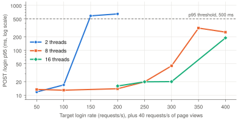
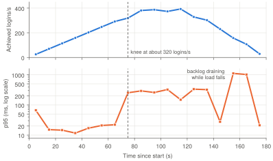

**Abstract.** This lab measures how the Flask authentication service from Lab 1 behaves under traffic, using k6 as the load generator and waitress as the production web server. At the target load of 50 requests per second the service passed every threshold with large margins: page views had a 95th-percentile latency of 1.7 ms and logins 21 ms. Stress and ramp tests located the capacity limit at about 300 logins per second with 8 server threads, where latency rises by an order of magnitude. Login cost is dominated by PBKDF2 password hashing. Reducing the hash iterations made logins about four times faster but would weaken password storage, so it is not an acceptable way to gain capacity.

## 1. Objective

Unit and integration tests show that an application works. A load test shows whether it keeps working when many users use it at the same time. The objectives were to run a load test at an expected traffic of 50 requests per second, to read its throughput, latency and error-rate results, and then to find where and why the service stops meeting its targets.

## 2. Test environment

The application is the one tested in Lab 1, unchanged. It was served by waitress 3.0.2 with 8 worker threads (`waitress-serve --listen=127.0.0.1:8000 --threads=8 --call app:create_app`) on an Apple M1 Pro (10 CPU cores, 16 GB RAM, macOS 27) with Python 3.12. The load was generated by k6 2.3.0 running on the same machine.

Running the load generator next to the server is a limitation: both compete for the same CPU cores, so the capacity limits reported here are lower than the service would reach with k6 on a separate machine. The guide also streams results to Grafana Cloud with `k6 cloud run --local-execution`. That step requires a personal account and token and was not used for the numbers below; the k6 end-of-test summary (`--summary-mode=full`) reports the same metrics per scenario, and the raw per-request data was exported with `--out csv` to compute per-request percentiles and per-second rates.

## 3. Workload model

The 50 requests per second are split between two scenarios that represent different users (Table 1). Both use the `constant-arrival-rate` executor, which starts a fixed number of iterations per second regardless of how fast the server responds. This is an open workload model: if the server slows down, k6 does not slow down with it but allocates more virtual users (VUs) to keep the rate. Each iteration sends exactly one request (`redirects: 0`), so iterations per second equal requests per second.

<b>Table 1.</b> Scenarios of the main test (<code>loadtests/load_test.js</code>, 2 minutes).

| Scenario | Request | Rate | Cost on the server |
|---|---|--:|---|
| `browse` | `GET /login` | 40/s | renders a template |
| `login` | `POST /login` with valid credentials | 10/s | PBKDF2 password verification |

A `setup()` function registers the test user once before the load starts. The test passes only if all six thresholds hold: fewer than 1% failed requests, an overall p95 latency under 500 ms, a login p95 under 800 ms, a measured rate of at least 45 requests per second, more than 99% of checks passing, and fewer than 10 dropped iterations. Percentiles are used instead of averages because an average hides slow outliers: the p95 is the latency that 95% of requests stayed under.

## 4. Results at 50 requests per second

<b>Table 2.</b> Per-request results of the 2-minute run (latencies in milliseconds).

| Request | Count | Mean | p95 | p99 | Max | Errors |
|---|--:|--:|--:|--:|--:|--:|
| `GET /login` | 4,800 | 0.97 | 1.73 | 4.1 | 39.5 | 0 |
| `POST /login` | 1,201 | 15.4 | 20.97 | 23.8 | 48.6 | 0 |

**Was the rate held for the full two minutes?** Yes. k6 sent 6,001 requests at a mean of 50.0 per second, every complete second contained between 49 and 52 requests, and no iteration was dropped.

**Which request is slower, and why?** A login takes about 16 times longer than a page view on average (15.4 ms against 0.97 ms) and about 12 times longer at the 95th percentile. A page view only renders a template. A login calls `verify_password()`, which recomputes the PBKDF2-HMAC-SHA256 hash with 100,000 iterations, about 11 ms of CPU work per request. This cost is intentional: it is what makes a stolen password hash expensive to brute-force.

**Did any threshold fail?** No. The overall p95 was 17.8 ms against a limit of 500 ms, the login p95 was 21 ms against 800 ms, no request failed, all checks passed and the measured rate was 50.0 per second. For users this means every request succeeded and 95% of them were answered in under 18 ms.

**How many virtual users were needed?** About one. The sampled number of active VUs never exceeded 1, although 30 were pre-allocated. This agrees with Little's law: the number of busy VUs is about the arrival rate multiplied by the response time, 40 × 0.001 s + 10 × 0.015 s ≈ 0.2. A rising VU count during a test is therefore an early sign that responses are slowing down.

## 5. Exercises

### 5.1 Stress test

The login rate was raised from 10 to 50 and then 100 requests per second with `loadtests/stress_test.js`, which takes the rate from an environment variable and keeps 40 page views per second. Both rates passed every threshold with latencies almost unchanged, so the rate was increased further to find the limit (Table 3). Runs lasted 30 seconds, or 1 minute near the limit, where results were noisier.

<b>Table 3.</b> Stress test with 8 server threads. Latencies are p95 in milliseconds.

| Logins/s | Total req/s | GET p95 | POST p95 | Dropped iterations | Failed thresholds |
|--:|--:|--:|--:|--:|---|
| 50 | 90 | 1.7 | 13.4 | 0 | none |
| 100 | 140 | 1.0 | 12.9 | 0 | none |
| 200 | 240 | 0.8 | 13.9 | 0 | none |
| 250 | 290 | 1.0 | 19.8 | 13 | dropped iterations |
| 300 | 339 | 16.0 | 44.9 | 33 | dropped iterations |
| 350 | 364 | 318.7 | 311.2 | 668 | dropped iterations, request rate |
| 400 | 392 | 227.5 | 252.9 | 1,192 | dropped iterations, request rate |

Thresholds started failing at about 250 logins per second (290 requests per second in total). The first threshold to fail was the dropped-iteration count, while latency was still low: short pauses made k6 need more than its 10 pre-allocated VUs, and an iteration is dropped each time a VU has to be created during the test. The service itself saturated between 300 and 350 logins per second, where the p95 latency of both requests jumped by a factor of 20 and k6 needed more than 200 VUs. Page views, although cheap, became just as slow as logins, because they wait in the same queue for a free server thread.

At 350 and 400 logins per second the measured request rate also failed, reporting about half the target. k6 computes this rate over the whole test duration, which includes the 30-second graceful stop while queued requests finish, so an overloaded 30-second test lasts 60 seconds and its average rate is halved.

### 5.2 Server threads

The stress test was repeated with 2 and 16 waitress threads (Figure 1).

<figure>

<figcaption><b>Figure 1.</b> 95th-percentile login latency against the target login rate for three thread counts. With 2 threads latency explodes at 150 logins/s; 8 and 16 threads stay flat up to about 300 logins/s.</figcaption>
</figure>

With 2 threads, only two logins can be hashed at the same time, so the capacity is at most 2 / 11.5 ms ≈ 170 logins per second. The service broke at 150 logins per second: the p95 rose to 583 ms and 1.95% of requests failed, rising to 26% at 200 logins per second. The failures had status 0, meaning the connection was reset. As requests queued, k6 opened more connections to keep the rate, and waitress closes connections beyond its default limit of 100.

Going from 8 to 16 threads changed almost nothing below 300 logins per second; at 400 it only degraded more gently (p95 188 ms and 98 dropped iterations, against 253 ms and 1,192). The work is CPU-bound. `hashlib.pbkdf2_hmac` releases Python's global interpreter lock, so threads do hash in parallel, but only up to the 10 physical cores, which k6 also uses. Threads beyond the number of free cores only wait for CPU time. More capacity therefore requires more cores, through more processes or more machines, not more threads.

### 5.3 Security against speed

The PBKDF2 iteration count in `auth.py` was reduced from 100,000 to 10,000 for this experiment and restored afterwards.

<b>Table 4.</b> Login latency (mean / p95, milliseconds) with 8 threads for two iteration counts.

| Logins/s | 100,000 iterations | 10,000 iterations |
|--:|---|---|
| 50 | 12.1 / 13.4 | 3.3 / 6.2 |
| 400 | 167 / 253, 1,192 dropped | 15.9 / 103, 188 dropped |
| 800 | not tested | 30 / 204, 3,058 dropped |

Logins became about 3.7 times faster, not 10 times, because the HTTP handling, session and redirect cost does not depend on the hash. Capacity improved, but the test still failed at 400 logins per second because the bottleneck moved to request handling in Python and to the CPU shared with k6.

This is a bad trade in production. The iteration count sets the cost of every password guess an attacker makes against a leaked user table. Dividing it by 10 lets an attacker test 10 times more guesses per second, so weak passwords are found 10 times sooner. The saving for the service is one hash per login, while the attacker benefits on billions of guesses. The OWASP Password Storage Cheat Sheet recommends 600,000 iterations for PBKDF2-HMAC-SHA256, so the current value is already low. Login capacity should instead be increased by scaling out, rate-limiting the login endpoint, or moving hashing to dedicated workers.

### 5.4 Ramping traffic

`loadtests/ramp_test.js` replaces the login scenario with a `ramping-arrival-rate` executor: 90 seconds from 0 to 50 logins per second, 30 seconds at the peak and 60 seconds back to 0. Over the whole run the median login latency stayed between 11 and 15 ms and all thresholds passed. The curve does not bend at 50 logins per second, which uses about 0.6 of one CPU core.

To observe the bend, the same ramp was run to a peak of 400 logins per second (Figure 2).

<figure>

<figcaption><b>Figure 2.</b> Ramp to 400 logins/s, in 10-second windows. Latency stays flat while the rate rises to about 290/s and bends at about 320/s (dashed line), where the p95 jumps from 22 ms to 254 ms.</figcaption>
</figure>

The curve bends at about 300 to 320 requests per second, the same knee as in the stress test. Beyond it the achieved rate stops following the target, 1,154 logins failed (among them 1,021 connection resets and 128 requests that hit k6's 60-second timeout), 800 iterations were dropped and the 200-VU limit was reached. The service also recovered slowly: the p95 stayed above one second for about 20 seconds after the load had already started to fall, while the queue of waiting connections drained.

### 5.5 Wrong-password traffic

`loadtests/wrong_password_test.js` adds a third scenario that sends invalid credentials at 5 requests per second and checks for status 401 and the error message.

<b>Table 5.</b> Failed-request rate with and without declaring 401 as an expected status.

| Run | `http_req_failed` | Result |
|---|--:|---|
| default response handling | 9.14% | threshold failed, k6 exit code 99 |
| `responseCallback: http.expectedStatuses(401)` | 0.03% | all thresholds passed |

The failed-request threshold does fail. By default k6 counts every 4xx and 5xx response as failed, and 5 of the 55 requests per second return 401 (about 9%), although the application behaves correctly and all checks pass. The fix is to declare 401 as the expected status of that request only. Setting it globally with `http.setResponseCallback()` would be wrong, because a 401 on a valid login is a real failure and must still be counted.

Two details were found while testing. Passing `responseCallback: undefined` does not restore the default but disables failure tracking for the request entirely, so the script only adds the option when it is enabled. The remaining 0.03% comes from `setup()`: when the test user already exists from a previous run, registration returns 400, which also counts as failed. It stays far below the threshold, but declaring 302 and 400 as expected in `setup()` would make the metric exact.

## 6. Limitations

Each configuration was measured once, and runs near the capacity limit varied between repetitions (for example, 250 logins per second failed in one 30-second run and nearly passed in a 1-minute run). The load generator shared the CPU with the server, the network path was the loopback interface, and the results apply to this laptop only. The figures should be read as the shape of the behaviour rather than as precise capacity numbers.

## 7. Conclusion

At the expected load of 50 requests per second the service has a large safety margin. Its capacity is limited by CPU-bound password hashing at about 300 logins per second on this machine with 8 threads; beyond that point requests queue, latency rises by an order of magnitude and connections are reset. Thread count only helps up to the number of available cores, and reducing hash iterations increases speed at an unacceptable security cost. The practical ways to scale are more processes or machines and rate limiting of the login endpoint. The thresholds turned each run into a pass or fail result, and the exercise with wrong passwords showed that the definition of a failed request must match the expected behaviour of the application.
